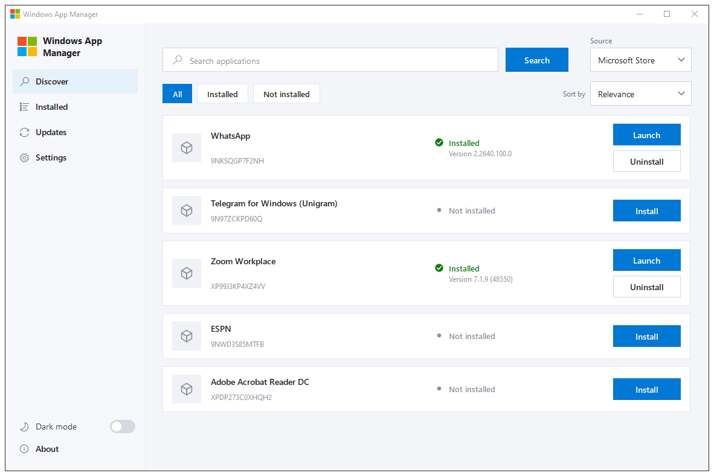

# Windows App Manager

Windows App Manager is a desktop application for finding, installing, updating, and removing Microsoft Store applications. It is aimed at someone who wants Store-like package management in a normal Windows window, without opening the Store app itself.

The window searches the live `msstore` catalog, shows up to ten featured applications when the search field is empty, and keeps install, update, and uninstall progress off the UI thread. An installed package can be launched from its card or from its own page.



## Prerequisites and dependencies

- Windows 10 or Windows 11, with the Microsoft Store source available to Windows Package Manager (App Installer).
- Visual Studio 2022, platform toolset v143, and the C++ desktop workload. The language standard is C++20.
- Qt 6.12.0 for MSVC 2022 64-bit. The project asks for the Qt installation named `6.12.0_msvc2022_64`.
- Qt MSBuild (`Qt.props` / `qt.targets`), so the GUI project can run `uic`, `moc`, and `rcc`.
- NuGet packages used by ApplicationCore and WingetPoC:
  - `Microsoft.Windows.CppWinRT` 3.0.260818.1
  - `Microsoft.WindowsPackageManager.ComInterop` 1.29.380

ApplicationGUI links `WindowsApp.lib` because it calls into that WinRT code. The process does not shell out to `winget.exe`.

## Build

Open `ApplicationManager.sln` in Visual Studio 2022, or build it with MSBuild. Build the solution. Building `ApplicationGUI.vcxproj` by itself can nest intermediates under `ApplicationGUI/ApplicationGUI/`.

Debug x64, which also builds ApplicationCore through the project reference:

```
MSBuild ApplicationManager.sln /t:ApplicationGUI /p:Configuration=Debug /p:Platform=x64 /p:QtMsBuild="<path to QtMsBuild>"
```

The executable is `x64/Debug/ApplicationGUI.exe`. Release x64 uses the same command with `Configuration=Release`. The executable is `x64/Release/ApplicationGUI.exe`.

ApplicationCore and WingetPoC set C++20 on Debug and Release, Win32 and x64, and they do not use a precompiled header. ApplicationGUI sets C++20 on Debug|x64 and Release|x64. The GUI project file has only x64 configurations. In the solution, the x86 entries for that project build x64.

Qt steps for the GUI are `uic` on `ui/MainWindow.ui`, `moc` on the headers in `include/`, and `rcc` on `resources/ApplicationGUI.qrc`. A stylesheet edit is packed again when the qrc file changes.

WingetPoC is the console check of the same service. Debug x64 writes `x64/Debug/WingetPoC.exe`.

## Run the Release build

The build does not copy Qt DLLs next to the executable. Starting `x64/Release/ApplicationGUI.exe` on its own fails because Windows cannot find `Qt6Core.dll`, `Qt6Gui.dll`, and `Qt6Widgets.dll`. Deploy those files from the same Qt kit that built the app, then start the executable from that folder.

From the repository root:

1. Build Release x64, as in the command above with `Configuration=Release`.
2. Deploy the Qt runtime. Replace the Qt path with the local `6.12.0` MSVC 2022 64-bit install:

```
<Qt>\6.12.0\msvc2022_64\bin\windeployqt.exe --release --compiler-runtime x64\Release\ApplicationGUI.exe
```

3. Start `x64\Release\ApplicationGUI.exe`.

`windeployqt` writes the Qt DLLs beside the executable and adds the plugins it needs, including `platforms\qwindows.dll`. Keep that folder together. Moving only `ApplicationGUI.exe` leaves the plugins behind and the window will not open.

If Windows then reports a missing Visual C++ runtime (`VCRUNTIME140.dll` or `MSVCP140.dll`), `--compiler-runtime` did not see a Visual Studio installation. Open a Developer Command Prompt for VS 2022, so `VCINSTALLDIR` is set, and run the same `windeployqt` command again. On a PC that does not have Visual Studio, install the Visual C++ Redistributable for Visual Studio 2022, x64.

Debug uses the same steps with `--debug` and `x64\Debug\ApplicationGUI.exe`.

## Architecture

Two boundaries keep the Windows Package Manager calls away from the widgets.

**ApplicationCore** is a static library. `WingetService` talks to `winrt::Microsoft::Management::Deployment` and the `msstore` catalog. Search, the featured list, the installed list, and the update list share one worker thread. Install, uninstall, and update each have their own worker, so a long download does not block the window or the next search. Launch looks up the installed package on that search worker, then the window thread starts it with `IApplicationActivationManager`, which is what a normal desktop process can use to activate a Store application.

**ApplicationGUI** is a Qt 6.12 Widgets application. It references ApplicationCore and posts worker results back with `QMetaObject::invokeMethod` and `Qt::QueuedConnection`. The shell lives in `ui/MainWindow.ui`. Application cards and the application page are `QWidget` types created in code. There is no QML and no Qt Quick.

**WingetPoC** is a small console program that calls the synchronous service methods. It does not know about Qt.

## What it does

From the sidebar:

- **Discover** searches the Store by application name and package id. An empty field loads up to ten featured Store applications from a fixed list of well-known names. That list is not the Store editorial shelf.
- **Installed** lists Microsoft Store packages that are installed for the current user, without the Discover filter chips.
- **Updates** lists installed Store packages that report an available update, again without those chips.
- **Settings** and **About** are separate pages. About names the author and links to the site.

All, Installed, and Not installed filter Discover only. Sort is Relevance or Name.

A card click opens a page for that package, with Back, status, versions, and the same actions as the card. Launch sits above Uninstall and uses the same primary button as Install. Update appears when a newer version is available.

## Solution

`ApplicationManager.sln` is a Visual Studio 2022 solution, toolset v143.

| Project | What it is allowed to know |
| --- | --- |
| ApplicationCore | The winget COM API, `AppInfo`, and `WingetService`. No Qt. |
| WingetPoC | The public synchronous methods on `WingetService`. |
| ApplicationGUI | `WingetService` and Qt Widgets. It does not call COM catalog APIs on its own. |

## Folder layout

```
ApplicationManager/
  ApplicationCore/
    include/          declarations
    src/              implementations
  ApplicationGUI/
    include/          declarations
    src/              implementations and main.cpp
    ui/               Qt Designer
    resources/        QSS, qrc, and icons
  WingetPoC/          WingetPoC.cpp
  docs/               project notes
  x64/Debug/          Debug x64 output
  x64/Release/        Release x64 output
```

Headers are included by file name. The compiler finds them through each project's include path.

## Backend

`WingetService` can:

- Search `msstore` and return up to ten matches. The composite catalog is used so an already installed package reports `InstalledVersion`.
- List up to ten featured packages by well-known name.
- List installed Store packages, and list those with `IsUpdateAvailable`.
- Install, update, and uninstall a package, with progress for queued, downloading, installing or updating, and completed or error.
- Cancel an install or update that is still queued or downloading. After the state is Installing or Updating, cancellation does not stop the installer.
- Resolve an installed package to an `AppUserModelId` so the GUI can launch it.

The synchronous methods remain for WingetPoC. The GUI uses the async methods.

## GUI

The list is built from catalog results. There is no mock catalog in the window.

Each card shows a package icon, the name, the package id, a status, and an action. Busy work uses a circular progress indicator drawn with `QPainter`. Error is a distinct state, with the message on the card. A new search keeps in-flight and finished status for the same package id, including a version the catalog has not returned yet.

Pause and Cancel appear while an install or update is queued or downloading. Pause cancels the operation and leaves the card on Paused. Resume starts that install or update again. Cancel returns an install to Not installed and an update to Update available.

Light theme is the default. Dark mode is a switch in the sidebar. Both themes use square corners. A circle is only the progress ring, the dark-mode switch, the check mark, and the status dot. Styles live in `resources/styles.qss` and `resources/styles-dark.qss`.

## Known limits

- A Store install or update usually skips Downloading. `InstallPackageAsync` and `UpgradePackageAsync` move from Queued to Installing, and `DownloadProgress` is already 1. Winget does not download the Store package itself. It hands the work to the Microsoft Store. Pause and Cancel, which are shown only during Queued and Downloading, often never appear for these packages. Any Store download progress that is reported arrives as installation progress.
- Pause is implemented by cancelling the active operation. The COM contract has no pause or resume method. Resume starts the operation again, so the download can start from the beginning.
- Once the state is Installing or Updating, Pause and Cancel are hidden, because cancellation does not stop the installer.
- Launch uses the same Windows activation path as Start. A package that Windows itself cannot start, because it has no usable app entry for the current user, cannot be started from this window either.
- The Store name index drops very common English words before lookup. `what` returns nothing, while `wha` and `whats` still find WhatsApp. This application forwards the typed query and shows the catalog answer. It does not yet match characters inside a name, explain that empty result, or search installed names locally.
- `AppInfo` has id, name, install state, and whether an update is available. The card treats the source as Microsoft Store.
- The finished application has been exercised on Windows 10. Windows 11 is a target and has not been run as a separate pass.

## Store search

Search sends the query as typed. The filter is the package name, case-insensitive contains, with a limit of ten. The catalog is a keyword index. Words such as `what`, `the`, and `for` are dropped because they do not distinguish one listing from another. If nothing remains, the catalog returns an empty list. That empty list is the catalog result.

Later advantages, still open, are to match the characters the user typed, to explain a query that the Store discarded, and to search installed applications with a local contains check. A remote name search cannot invent hits the catalog refuses to return.

## Author

Developed by Vanja Sretenovic.

- [github.com/vanja032](https://github.com/vanja032)
- [vanjasretenovic.com](https://vanjasretenovic.com)
